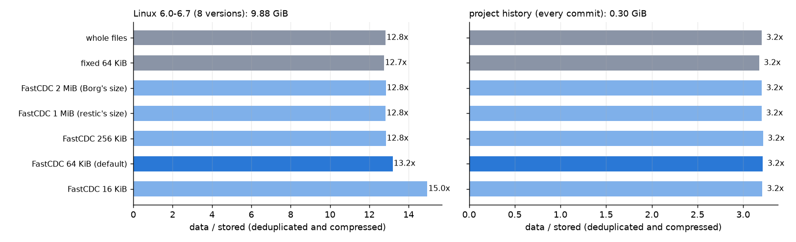
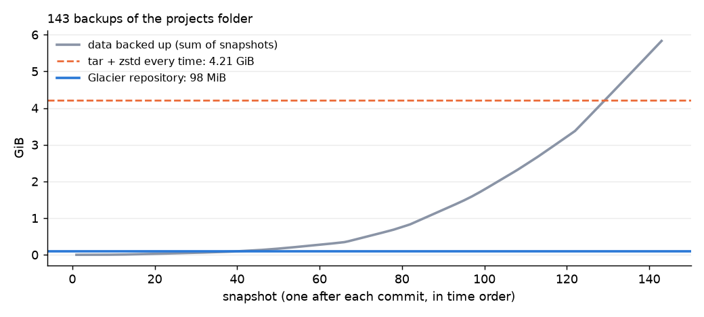

# Glacier

Deduplicating, encrypted backups, written from scratch.

- **Rust (`core/`)**: the backup engine and CLI.
  - Content-defined chunking with FastCDC.
  - A content-addressed store of encrypted, compressed chunks, grouped into pack files.
  - XChaCha20-Poly1305 authenticated encryption, with keys protected by Argon2id.
  - Incremental snapshots.
  - `check`, which verifies the structure and, with `--read-data`, every stored byte.
  - `forget`/`prune`, which remove data no snapshot needs.
  - A local-directory backend and an S3 backend (Signature V4 written here).
- **Go (`service/`)**:
  - `glacierd` runs scheduled backups with a retention policy to a local or S3 destination, keeps their history, and serves the web interface.
  - `s3lite` is a minimal S3-compatible server (SigV4 authentication) for testing the S3 path locally.
- **TypeScript (`web/`)**: browsing snapshots and their directories, downloading files, restoring a directory to a folder, schedules with their run history, and repository checks.
- **Python (`eval/`)**: the evaluation, with deduplication, speed, interruption and corruption experiments.



## Results

Machine: Windows 11, 16 logical cores, NVMe SSD. Every number comes from the scripts in `eval/`, and the raw output is in `results/`. restic and Borg were not run here (the project uses no third-party binaries). They are compared through their chunk-size parameters, reproduced with this chunker, and through measured baselines on the same data:
- a tar + zstd archive every time;
- fixed-size chunks;
- whole-file deduplication.

The data:
- **Linux kernel 6.0–6.7**: the eight release tarballs, 9.9 GiB and about 80,000 files per version. On Windows, at most 79 entries per version had to be skipped: symlinks, the reserved names `aux.c` and `con.h`, and 13 names that differ only in case.
- **Project history**: every commit of the 50 git repositories in my projects folder, 143 commits in all. Only tracked files are included, not models, datasets or build outputs.

### Deduplication

`glacier analyze` stores nothing. It counts the unique chunks under each strategy and their zstd-compressed size, which is what Glacier stores apart from 41 bytes of encryption overhead per chunk.

| Strategy | Kernel 6.0–6.7: stored | Kernel: ratio | Project history: stored | Project history: ratio |
|---|---|---|---|---|
| FastCDC, 16 KiB average | 677 MiB | **15.0×** | 95.7 MiB | 3.21× |
| **FastCDC, 64 KiB (Glacier's default)** | **767 MiB** | **13.2×** | **95.5 MiB** | **3.22×** |
| FastCDC, 256 KiB | 788 MiB | 12.8× | 95.5 MiB | 3.22× |
| FastCDC, 1 MiB (restic's average) | 789 MiB | 12.8× | 96.0 MiB | 3.20× |
| FastCDC, 2 MiB (Borg's default) | 788 MiB | 12.8× | 96.0 MiB | 3.20× |
| Fixed 64 KiB chunks | 794 MiB | 12.7× | 96.8 MiB | 3.18× |
| Whole files | 789 MiB | 12.8× | 96.0 MiB | 3.20× |

The ratio is data size divided by stored size. Logical sizes: 10,121 MiB for the kernel, 307 MiB for the project history.

What the table shows:
- **Most of the saving in both datasets comes from files that do not change between versions.** Whole-file deduplication alone gets 12.8× on the kernel, because most of its files are smaller than the chunks.
- **Content-defined chunks pay off on files that changed a little.**
  - At 64 KiB they store 22 MiB less than at restic's or Borg's sizes, and at 16 KiB 112 MiB less (13% of the total). The cost is 1.5 times as many chunks to index.
  - At large sizes, chunking behaves like whole-file deduplication, because a typical source file is one chunk.
- **Fixed 64 KiB chunks are the worst option**: an insertion shifts every later boundary (a unit test shows this directly).
- **The project history dedups less (3.2×).** Its 143 commits are spread over 50 small repositories, so many files exist in one or two versions only.

### Backup and restore speed

Kernel versions are backed up one after another into one repository. Each is a new folder, so every file is read and only new chunks are stored. Before each run the version is read once, so that Glacier and tar both find the files in the operating system's cache. Before that change, Glacier ran first on a cold cache and tar right after it, which made the comparison unfair.

| | Glacier | tar + zstd -3 (Python's tarfile) |
|---|---|---|
| Back up one version (1.2–1.3 GiB, about 80,000 files) | **14–16 s** (about 85 MiB/s) | 37–40 s |
| Space for linux-6.0 | 259 MiB | 190 MiB |
| Space for each later version | **+74 to +84 MiB** | +192 to +202 MiB |
| Space for all 8 versions (9.9 GiB) | **831 MiB** | 1,568 MiB |
| Back up linux-6.7 again, nothing changed | **6.4 s** (82,359 files checked by size and time) | (another 39 s and 202 MiB) |
| Restore linux-6.7 | **85 s**, every file identical | 151 s to extract |

Restoring is slower than backing up because it creates about 82,000 files, which is expensive on Windows with real-time antivirus scanning. Extracting the tar archive pays the same cost and takes longer.

**The project folder after each of its 143 commits**, in time order, which is like a daily backup of a folder that keeps changing:

| | Glacier | tar + zstd every time |
|---|---|---|
| Data backed up, summed over all snapshots | 5.8 GiB | 5.8 GiB |
| Stored | **97.8 MiB** | 4,311 MiB |
| Total time for 143 backups | **71 s** (0.5 s each) | 141 s |
| Restore the newest state (3,308 files, 121 MiB) | 4.3 s, identical | |



### S3 destination

`python -m glacier_eval.s3` backs up linux-6.0 (1.2 GiB) through `s3lite`, the project's own S3-compatible server on the same machine, and compares the result with a local repository:

| | Local directory | S3 (s3lite, localhost) |
|---|---|---|
| Backup | 17.2 s | 16.2 s |
| Restore (identical) | 81.7 s | 78.3 s |
| `check --read-data` | 1.1 s | 1.8 s |
| Stored | 259 MiB | 259 MiB |

One measurement shaped the code:
- At first, restoring from S3 took 406 s against 78 s locally. It issued one HTTP range request per chunk, about 90,000 of them.
- Now a remote backend loads whole 16 MiB packs into a small cache, and files are restored in the order their chunks were stored.
- With that, restoring from S3 is as fast as restoring locally.

### Consistency after interruptions

`python -m glacier_eval.interrupt` starts a backup of linux-6.0 into an empty repository 15 times and kills it at a random point between 10% and 90% of a full backup's duration (TerminateProcess). After each kill:

| Check | Result |
|---|---|
| Kills that landed during the backup | 15 of 15 |
| `check --read-data` after the kill (every snapshot, tree, index entry and chunk verified) | **15 of 15 passed** |
| `check --read-data` after the backup was resumed and completed | 15 of 15 passed |
| Data the resumed backup did not upload again | up to 62% (it depends on how far the killed run got) |
| Final restore | identical to the source |
| `prune` | removed the packs left unreferenced |

Writes go in order, so a crash at any point leaves a valid repository:
1. pack files;
2. then an index naming them (every 2 packs, so an interrupted backup keeps its progress);
3. then the snapshot.

Each object is written to a temporary file, fsynced and renamed, or sent as a single S3 PUT. A crash therefore leaves at worst complete packs that no index names yet. `check` reports them as unreferenced, and `prune` deletes them.

### Integrity

`python -m glacier_eval.corrupt` flips one random bit in one random file of a repository 200 times (restoring it after each trial).

| File hit | Trials | Detected by `check --read-data` |
|---|---|---|
| packs (`data/`) | 70 | 70 |
| indexes | 60 | 60 |
| snapshots | 57 | 57 |
| key file | 7 | 7 |
| `config` | 6 | 6 |
| **Total** | **200** | **200** |

In all 200 trials a full restore of the newest snapshot was also attempted. **No restore produced a file with wrong content.** In 175 trials the restore reported errors. In the other 25, the flipped bit was in data the newest snapshot does not use.

How the checks cover each kind of file:
- Every stored object is authenticated with Poly1305.
- Each chunk's plaintext is checked against its id, a keyed BLAKE3 hash.
- A pack's name is the BLAKE3 hash of its content.
- `config` carries a MAC. Before that MAC was added, a flipped digit in the plain-JSON `config` could go unnoticed.

## How it works

**Chunking (`chunker.rs`)**: FastCDC (Xia et al., 2016) uses a gear rolling hash with normalized chunking: cutting is harder before the average size and easier after it. Glacier uses an average of 64 KiB, with a minimum of 16 KiB and a maximum of 256 KiB. The gear table comes from a secret per-repository seed, as restic and Borg also randomise their chunkers, so that chunk sizes do not reveal known files.

**Keys and encryption (`crypto.rs`)**:
- Each repository has random master keys: an encryption key, an id key and the chunker seed.
- They are sealed in `keys/<id>` under a key derived from the password with Argon2id (64 MiB, 3 passes by default).
- Every object is sealed with XChaCha20-Poly1305 under a random 192-bit nonce. A flag inside says whether the payload was compressed with zstd.
- Chunk ids are keyed BLAKE3 hashes of the plaintext, so they reveal nothing about content to someone without the keys.

**Repository (`repo.rs`)**:

```text
config            format version, id, chunk size, MAC
keys/<id>         master keys, sealed with the password-derived key
data/<xx>/<pack>  about 16 MiB of sealed chunks, then a sealed header listing them
index/<id>        sealed (chunk id, kind, pack, offset, length) lists
snapshots/<id>    sealed JSON: time, host, paths, root tree, parent, summary
locks/<id>        shared (backup) or exclusive (prune) locks, refreshed every 5 minutes
```

**Backup (`backup.rs`)**:
- The source tree is scanned first.
- Files are then chunked in parallel (rayon). A chunk the repository already has is not stored again.
- Directories become tree objects (JSON, deduplicated like chunks), and the snapshot is written last.
- With a parent snapshot (by default, the newest of the same paths from the same host), a file whose size and modification time are unchanged reuses its chunk list without being read.

**Restore (`restore.rs`)**:
- Files are restored in parallel, in storage order, and every chunk is verified.
- A file that fails verification is reported and removed, never left with wrong content.
- Modification times and read-only flags are restored.

**Check and prune**:
- `check` walks every snapshot's trees and checks every reference against the index.
- With `--read-data` it also reads every pack, verifies its hash and header, and decrypts and verifies every chunk.
- `prune` deletes packs no snapshot uses and rewrites packs that are mostly unused. It writes one new index before deleting the old ones and the old packs.

**S3 (`backend.rs`)**: path-style requests signed with Signature V4, which reproduces AWS's published example. ListObjectsV2 is used with pagination, and ranged GETs for chunks.

**Service (`service/`)**:
- `glacierd` reads a JSON configuration of jobs: repository, paths, exclusions, interval and retention.
- For each job it runs `glacier backup`, then `forget --prune`. A failure is retried after a shorter delay, and the run history is kept in a state file.
- It starts one `glacier serve` per repository to browse it, and proxies to it.
- `s3lite` stores objects as files and verifies signatures, payload hashes and request time. It refuses path traversal.

## Running it

```bash
cd core && cargo build --release
```

```bash
cd web && npm install && npm run build
```

```bash
core/target/release/glacier init --repo D:/backups/main
```

```bash
core/target/release/glacier backup --repo D:/backups/main C:/work --exclude node_modules --exclude target
```

The password comes from `GLACIER_PASSWORD` or `--password-file`.

```
glacier init      --repo URL [--chunk-avg 64KiB]
glacier backup    --repo URL PATH... [--exclude NAME]... [--tag T] [--full]
glacier snapshots --repo URL
glacier ls        --repo URL SNAPSHOT [PATH]
glacier restore   --repo URL SNAPSHOT --target DIR [--path P]
glacier dump      --repo URL SNAPSHOT PATH
glacier check     --repo URL [--read-data]
glacier forget    --repo URL [--keep-last N] [--keep-daily N] [--prune]
glacier prune     --repo URL [--repack-below 0.5]
glacier serve     --repo URL [--web web/dist]
glacier analyze   PATH... [--avg 64KiB | --fixed 64KiB | --whole-file]
```

URL is a directory, or `s3:http://host:port/bucket/prefix` with `AWS_ACCESS_KEY_ID` and `AWS_SECRET_ACCESS_KEY` set. Scheduled backups with the web interface:

```bash
cd service && go run ./cmd/glacierd -config glacierd.json
```

The configuration format is documented in `service/cmd/glacierd/main.go`. The evaluation:

```bash
python -m venv .venv && .venv/Scripts/pip install -r eval/requirements.txt
```

```bash
cd eval && ../.venv/Scripts/python -m glacier_eval.fetch && ../.venv/Scripts/python -m glacier_eval.dedup && ../.venv/Scripts/python -m glacier_eval.bench
```

```bash
cd eval && ../.venv/Scripts/python -m glacier_eval.interrupt && ../.venv/Scripts/python -m glacier_eval.corrupt && ../.venv/Scripts/python -m glacier_eval.s3 && ../.venv/Scripts/python -m glacier_eval.report
```

`fetch` downloads 1.1 GB of kernel tarballs (about 11 GB extracted) and exports the project repositories' commits.

## Limitations

- **One writer at a time per repository.** Concurrent backups are allowed, since they take shared locks, but each writes its own index files and does not see the others' chunks until it reopens the repository. `prune` needs an exclusive lock.
- **The whole index is held in memory**, about 100 bytes per chunk: about 18 MB for this kernel repository.
- **What someone with access to the storage can see:** the number and sizes of packs, and when they were written. File names, contents, sizes and snapshot details are all encrypted.
- **Restic and Borg themselves were not run.** Their chunk sizes are emulated with FastCDC, while their own chunkers (Rabin for restic, buzhash for Borg) cut differently. Their speeds were not measured here.
- **On Windows**, a few kernel entries cannot exist (listed above). Symlinks are stored but restoring them may need privileges. POSIX permissions and ownership are not kept, only the read-only flag.

## Tests

```bash
cd core && cargo test
```

```bash
cd service && go test ./...
```

```bash
cd eval && ../.venv/Scripts/python -m pytest -q tests
```

```bash
cd web && npm test
```

What each suite covers:
- **Rust (14 tests)**:
  - chunk boundaries, including that an insertion only changes nearby chunks;
  - sealing and opening, with tampering at the nonce, the body and the tag;
  - key files and wrong passwords;
  - SigV4 against AWS's example;
  - pack headers against the index, and locks;
  - end to end: backup, incremental backup, restore of two snapshots and of one subtree with times preserved, `check --read-data`;
  - bit flips in every repository file kind, detected and never restored wrongly;
  - an interrupted backup followed by forget and prune;
  - the retention policy.
- **Go**: SigV4 against AWS's example, objects, ranges and paginated listing, refused requests (wrong secret, path traversal, a body that does not match its hash, an old request), and scheduling with retries, retention and persisted history.
- **Python**: the Windows-name filter, and a backup, restore, check and corruption round trip through the CLI.
- **Web**: formatting, paths and sorting.

CI runs the Rust tests and clippy on Ubuntu and Windows, the Go tests, a backup and restore through `s3lite` on Linux, and the web tests and build.

## Data

- **Linux kernel**: release tarballs from [cdn.kernel.org](https://cdn.kernel.org/pub/linux/kernel/v6.x/) (GPL-2.0), downloaded by `fetch` and not committed.
- **Project history**: my own repositories, used locally and not committed.
- **Chunk sizes for comparison**:
  - restic: Rabin fingerprints, 512 KiB–8 MiB, 1 MiB average;
  - Borg: buzhash with default parameters `19,23,21,4095`, 512 KiB–8 MiB, about 2 MiB.

## License

MIT
